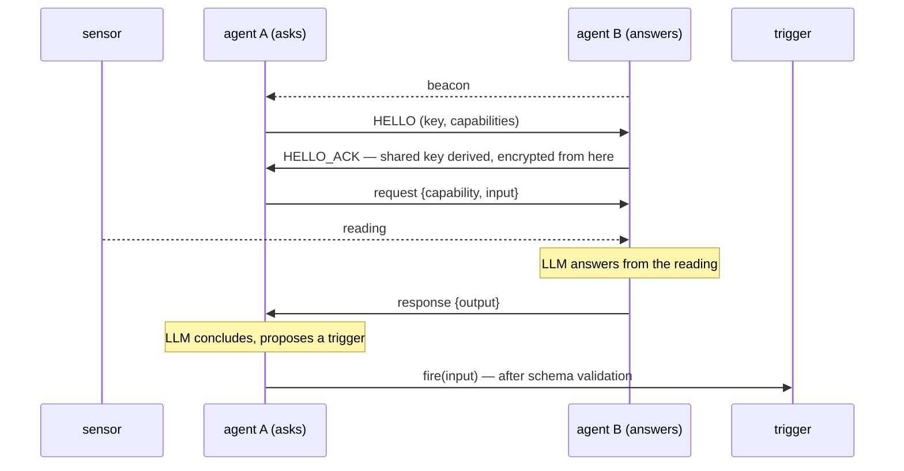

<p align="center">
  
</p>

# loquor-aac

**loquor** — Latin for *"I speak"*. **aac** — agent-to-agent communication.

AI agents on separate devices that find each other, talk securely and
work together **without internet, cloud or server** — over the local
radio they have: Wi-Fi or Bluetooth. Each device runs its own small LLM,
has its own sensors and its own ways to act. Together they do what none
of them could alone.

1. A device = an **agent**: a local LLM + what it can measure (**sensors**) + what it can do (**triggers**).
2. Agents in range **discover each other, verify who they are, and ask each other questions**, encrypted, peer to peer.
3. The LLM reasons over its own sensor data and the peers' answers, and **proposes an action**; the device checks the proposal and acts.

Where this matters: a factory floor, a hospital waiting area, a farm, a
convoy, a mine, a disaster zone — anywhere the network is unreliable or
absent, and the devices that are physically there are the only ones that
can act.

## Get an agent running

On a laptop, a Raspberry Pi, or any Linux or macOS device with Python 3.10:

```bash
git clone https://github.com/yzhbankov/loquor-aac.git && cd loquor-aac
./install.sh                      # Python, the package, Ollama, a model sized for this device
source .venv/bin/activate
loquor init my_agent              # a working agent: profile, prompt, one sensor, one trigger
loquor run my_agent/agent.json    # on the air; Ctrl-C to stop
```

That is one agent. Do the same on a second device, then tell each which
radio to use and they find each other — no pairing, no addresses:

```bash
loquor config set transport wifi         # same Wi-Fi or a phone hotspot (no internet needed)
loquor config set transport bluetooth    # or no network at all
```

Not every device needs a brain. A **sensor node** only measures and
reports — no LLM, no Ollama, a Raspberry Pi Zero is enough — and any
agent in range pulls its readings as data:

```bash
./install.sh --node                      # on the small device: no Ollama, no model
loquor init my_node --node               # sensors + sensor_report, nothing else
loquor run my_node/agent.json
```

What you will see, from the second device's agent:

```
my-agent-3d42fca5 | id 3d42fca5… | model qwen2.5:3b (ollama) | transport wifi (192.168.1.20) | visible | Ctrl-C to stop
status: loquor status "My Agent" · trace: ~/.loquor/run/my-agent.trace.jsonl
12:00:03  my-agent-3d42fca5 met greenhouse-6b2a6c20: I am Greenhouse. I report… ['greenhouse_status', 'sensor_report']
12:00:04  greenhouse-6b2a6c20 asks for my_agent_status: What is the load and temperature at your device?
12:00:06  LLM  1.8 s  "Another agent asks: What is the load…" -> "Load is 0.4 and it is 21.3 °C here."
12:00:06  my-agent-3d42fca5: answered greenhouse-6b2a6c20: Load is 0.4 and it is 21.3 °C here.
```

Every step in detail, per OS, with the Bluetooth prerequisites and how
to run at boot: [docs/INSTALL.md](docs/INSTALL.md).

## Make it yours

The folder `loquor init` wrote is the whole agent. Three ways to give it
your own sensors and triggers, by rising effort:

**1. A shell command, no Python.** Anything with a CLI is a sensor or a
trigger. In `agent.json`:

```json
"sensors":  [ { "type": "command", "name": "cpu_temp", "command": "vcgencmd measure_temp | tr -dc '0-9.'", "unit": "°C", "interval": 10 } ],
"triggers": [ { "type": "command", "name": "beep", "command": "aplay /usr/share/sounds/beep.wav",
                "description": "Sound the buzzer once.", "input_schema": { "type": "object" } } ]
```

**2. A function.** The value it returns is the reading; its docstring is
what the LLM reads:

```python
def soil_moisture():
    """Soil moisture at the north bed, in percent."""
    return read_adc(channel=0) / 40.95
```

```json
{ "type": "sensors.py:soil_moisture", "name": "soil", "unit": "%", "interval": 60 }
```

**3. A class**, when the device needs opening, state or a push loop. One
method each:

```python
from loquor import Sensor, Trigger

class Thermometer(Sensor):                      # UART, I²C, GPIO, HTTP… your call
    name, unit, interval = "thermometer", "°C", 10
    async def read(self):
        return self.reading(await read_my_device())

class Pump(Trigger):
    name = "pump"
    description = "Switch the irrigation pump on or off."      # the LLM reads this
    input_schema = {"type": "object", "properties": {"on": {"type": "boolean"}}, "required": ["on"]}
    async def fire(self, input):                                 # input already validated
        await set_relay(input["on"])
        return {"on": input["on"]}
```

`loquor check my_agent/agent.json` loads it all, reads every sensor
once and tells you what is wrong before anything goes on the air.

**Two roles.** Put an LLM where a decision is made; put a **node** where
something is measured or switched. A node is a profile with sensors, the
`sensor_report` skill and, if it can act, triggers plus `offer_triggers`:
it runs the same protocol (beacons, handshake, encryption), answers with
numbers, not prose, and advertises its triggers in its capability card.
An agent with the `collect` skill pulls every node's readings each round,
reasons over the table once, and fires a trigger if the readings call
for it — its own, or one on a node (`tank-node:valve`), validated on both
sides:

```json
{ "type": "collect", "interval": 30,
  "goal": "Keep soil moisture above 30 %; water through the tank node's valve, only if the tank is above 10 %." }
```

**The LLM's behaviour** is `prompt.txt` (its persona; `{sensors}` is
replaced by the current readings) and `description` in `agent.json`
(what other agents' LLMs read to decide whether to ask you). **The
model** is a device setting, so the same profile runs on a laptop and a
Pi: `loquor config set model qwen2.5:1.5b`. Give the agent a **goal**
and a trigger and it acts on its own:

```json
{ "type": "goal", "goal": "Warn the person here if any device nearby is overheating.", "triggers": ["notify"] }
```

Every field: [docs/USAGE.md](docs/USAGE.md). The contracts for sensors,
triggers and skills: [docs/DEVELOPMENT.md](docs/DEVELOPMENT.md).

## When something is off

| question | command |
|---|---|
| Can this device run an agent at all? | `loquor doctor` — Python, Ollama, model, radio; each failure with its fix |
| Does my profile build? Do my sensors read? | `loquor check agent.json` |
| What does the running agent see and know? | `loquor status` — peers, readings, triggers fired, last LLM calls, goals |
| Why did it decide *that*? | `loquor trace "My Agent" --full` — every prompt and reply of the last run |
| What went over the radio? | `loquor run … --wire all` (envelopes), `-v` (beacons, readings) |

## Two demos

All run real agents, real protocol, real local LLMs. Only the hardware
is **emulated**: the sensors invent plausible readings and the triggers
print to the terminal instead of driving a display or a relay.

| demo | what it shows | files that make it |
|---|---|---|
| [**Weather & Clothes**](demo/weather_and_clothes/README.md) | two agents: a weather station with a sensor, and an advisor that finds it, asks for the forecast and shows an outfit card | 1 sensor, 1 trigger, 2 profiles |
| [**Emergency Triage**](demo/triage/README.md) | three triage chairs measuring patients, and a nurse's device that asks all of them, decides whom to see first and shows the board | 1 sensor, 1 trigger, 4 profiles |
| [**Greenhouse**](demo/greenhouse/README.md) | three sensor **nodes** with no LLM, one with a valve it offers, and one controller that collects their readings every 15 s, waters through the node's valve and vents | 0 sensors to write, 1 trigger, 4 profiles |

```bash
# weather & clothes: two terminals on one computer (the default transport is localhost)
loquor run demo/weather_and_clothes/weather_agent.json
loquor run demo/weather_and_clothes/clothing_agent.json

# the same on two devices over Wi-Fi or Bluetooth: add --transport wifi | bluetooth to both
```

Verified between a Mac and an Ubuntu laptop over Wi-Fi and over
Bluetooth: discovery, handshake, encrypted request and reply, goal
complete — no network at all.

## How it works

```
   device A  (robot, chair, sensor node…)               device B  (laptop, handheld, machine…)
 ┌──────────────────────────────┐                     ┌──────────────────────────────┐
 │  sensors ─▶ LLM ─▶ triggers  │◀── Wi-Fi / BLE ───▶│  sensors ─▶ LLM ─▶ triggers  │
 │            agent             │  beacon · handshake │            agent             │
 └──────────────────────────────┘  encrypted messages └──────────────────────────────┘
```

1. **Identity.** First run: the agent makes a keypair and keeps it. Its id is a hash of its public key.
2. **Discovery.** Every 10 s it sends a 16-byte **beacon**: "I'm here, here's what I can do."
3. **Handshake.** On hearing a new beacon the agents exchange public keys and capability cards (**HELLO / HELLO_ACK**) and derive a shared key.
4. **Messages.** From then on every message is encrypted, signed, de-duplicated and acknowledged.
5. **Skills.** A request names a *capability*; the agent hands it to the skill that owns it. Skills read sensors, call the LLM, ask peers, fire triggers.
6. **Safety.** The LLM never fires anything itself. It *proposes* a trigger and an input; the agent validates the input against the trigger's schema and only then acts.



Byte-level detail and every rule: [docs/PROTOCOL.md](docs/PROTOCOL.md).

## Architecture

Five layers, one small interface each. Lower layers never import upper ones.

```
 ~/.loquor/config.json  (this device: transport · model · beacon interval · logging)
 my_agent/agent.json ──▶ agent      dispatches requests to skills; hubs for sensors and triggers
                          ├─ skills     business logic: llm_answer · goal · collect · sensor_report · offer_triggers · yours
                          ├─ sensors    drivers that produce readings            (yours: one class)
                          ├─ triggers   drivers that perform actions             (yours: one class)
                          ├─ reasoning  the LLM behind one method                (Ollama · none · template · tracing)
                          └─ protocol   identity · beacons · handshake · encrypted envelopes (AMP v1)
                               └─ transports   bytes over a link: localhost · wifi · bluetooth
 loquor  (doctor · init · check · run · status · trace · config · service)
```

An agent is a **JSON profile** that names its parts; each part is a
built-in name or `"file.py:Class"`. The full design, interfaces and the
reasons behind them: [docs/ARCHITECTURE.md](docs/ARCHITECTURE.md).

## Develop

```bash
pip install -e ".[dev]"
python -m pytest            # 119 tests, no model, network or radio needed, ~5 s
```

## Documentation map

| read this for | document |
|---|---|
| installing on a laptop, a Pi or a device; Bluetooth prerequisites; running at boot | [docs/INSTALL.md](docs/INSTALL.md) |
| the `loquor` commands, the device config, every profile field, debugging | [docs/USAGE.md](docs/USAGE.md) |
| writing sensors, triggers, skills, transports; testing; conventions | [docs/DEVELOPMENT.md](docs/DEVELOPMENT.md) |
| the layers, interfaces and design decisions | [docs/ARCHITECTURE.md](docs/ARCHITECTURE.md) |
| what goes on the wire, with diagrams | [docs/PROTOCOL.md](docs/PROTOCOL.md) |
| why the project exists, where it is going | [docs/VISION.md](docs/VISION.md) · [docs/POC_PLAN.md](docs/POC_PLAN.md) |
| running and reading the demos | [weather & clothes](demo/weather_and_clothes/README.md) · [triage](demo/triage/README.md) |
| the logo and app icon, and how to use them | [assets/](assets/README.md) |

## Status

| done | next |
|---|---|
| AMP v1: persisted identity, signed CBOR envelopes, beacons, handshake, encryption, acknowledgements, visibility policies | Session transports (bulk data over TCP / L2CAP) |
| Extensions: capability queries, session negotiation, relay store-and-forward, trust levels with pinned keys | Pairing ceremony (QR / fingerprint) from the CLI |
| Sensors and triggers with schema-validated LLM proposals; `goal` skill that gathers from many peers; `collect` skill; LLM-free nodes that report readings and offer triggers | A reference node firmware for microcontrollers (ESP32) |
| Wi-Fi and Bluetooth transports, verified between a Mac and an Ubuntu laptop | UWB proximity; relay gossip message |
| One-script install, `loquor` CLI with doctor / init / check / status / trace, device config, boot service | A PyPI release |

## License

[Apache 2.0](LICENSE)
