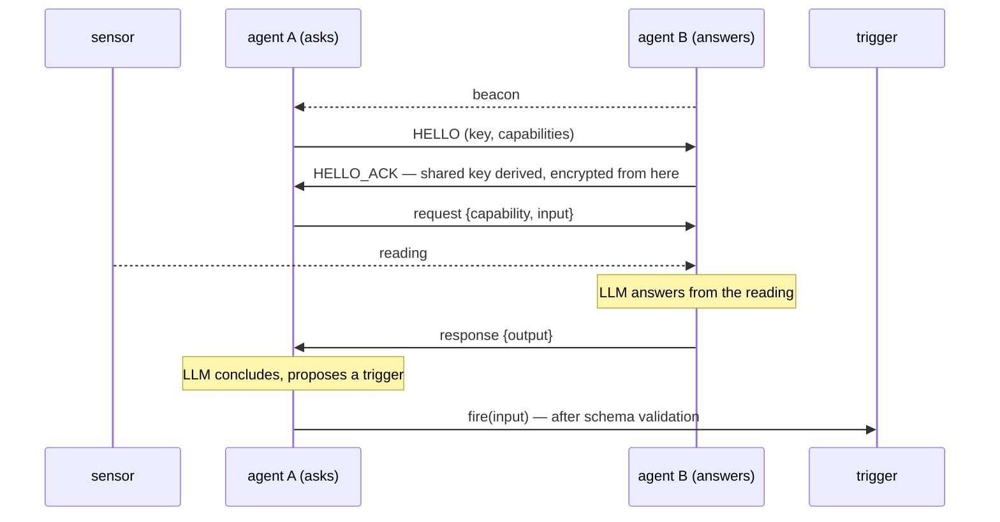

# loquor-aac

**loquor** — Latin for *"I speak"*. **aac** — agent-to-agent communication.

AI agents on separate devices that find each other, talk securely and
work together **without internet, cloud or server** — over the local
radio they have (Wi-Fi today, Bluetooth next). Each device runs its own
small LLM, has its own sensors and its own ways to act. Together they
do what none of them could alone.

## The idea in three lines

1. A device = an **agent**: a local LLM + what it can measure (**sensors**) + what it can do (**triggers**).
2. Agents in range **discover each other, verify who they are, and ask each other questions**, encrypted, peer to peer.
3. The LLM reasons over its own sensor data and the peers' answers, and **proposes an action**; the device checks the proposal and acts.

Where this matters: a factory floor, a hospital waiting area, a farm, a
convoy, a mine, a disaster zone — anywhere the network is unreliable or
absent, and the devices that are physically there are the only ones that
can act.

## How it works

```
   device A  (robot, chair, sensor node…)               device B  (laptop, handheld, machine…)
 ┌──────────────────────────────┐                     ┌──────────────────────────────┐
 │  sensors ─▶ LLM ─▶ triggers  │◀── Wi-Fi / BLE ───▶│  sensors ─▶ LLM ─▶ triggers  │
 │            agent             │  beacon · handshake │            agent             │
 └──────────────────────────────┘  encrypted messages └──────────────────────────────┘
```

1. **Identity.** First run: the agent makes a keypair and keeps it. Its id is a hash of its public key.
2. **Discovery.** Every 10 s it sends a 16-byte **beacon**: "I'm here, here's what I can do."
3. **Handshake.** On hearing a new beacon the agents exchange public keys and capability cards (**HELLO / HELLO_ACK**) and derive a shared key.
4. **Messages.** From then on every message is encrypted, signed, de-duplicated and acknowledged.
5. **Skills.** A request names a *capability*; the agent hands it to the skill that owns it. Skills read sensors, call the LLM, ask peers, fire triggers.
6. **Safety.** The LLM never fires anything itself. It *proposes* a trigger and an input; the agent validates the input against the trigger's schema and only then acts.



Byte-level detail and every rule: [docs/PROTOCOL.md](docs/PROTOCOL.md).

## Two demos

Both run real agents, real protocol, real local LLMs. Only the hardware
is **emulated**: the sensors invent plausible readings and the triggers
print to the terminal instead of driving a display or a relay. Swap one
file and the same agents run on real devices.

| demo | what it shows | files that make it |
|---|---|---|
| [**Weather & Clothes**](demo/weather_and_clothes/README.md) | two agents: a weather station with a sensor, and an advisor that finds it, asks for the forecast and shows an outfit card | 1 sensor, 1 trigger, 2 profiles |
| [**Emergency Triage**](demo/triage/README.md) | three triage chairs measuring patients, and a nurse's device that asks all of them, decides whom to see first and shows the board | 1 sensor, 1 trigger, 4 profiles |

### Run a demo — option 1: one computer

Needs **Python 3.10+** and **[Ollama](https://ollama.com)** running.

```bash
git clone https://github.com/yzhbankov/loquor-aac.git && cd loquor-aac
python3 -m venv .venv && source .venv/bin/activate
pip install -r requirements.txt
ollama pull qwen2.5:3b                                            # once, ~2 GB

# weather & clothes: two terminals
python run_agent.py demo/weather_and_clothes/weather_agent.json
python run_agent.py demo/weather_and_clothes/clothing_agent.json

# triage: four terminals (chairs first, then the nurse)
python run_agent.py demo/triage/chair_1.json --wire off
python run_agent.py demo/triage/chair_2.json --wire off
python run_agent.py demo/triage/chair_3.json --wire off
python run_agent.py demo/triage/nurse_agent.json --wire off
```

The agents talk over the computer's loopback interface; no network needed.

### Run a demo — option 2: several devices

Same setup on each device (laptops, Raspberry Pis — anything with Python
and a local model), all on one Wi-Fi or a phone hotspot, no internet
required. Add `--transport wifi` to every command:

```bash
python run_agent.py demo/weather_and_clothes/weather_agent.json --transport wifi    # device A
python run_agent.py demo/weather_and_clothes/clothing_agent.json --transport wifi   # device B
```

Nothing to pair: the agents find each other by beacons and exchange keys
in the handshake. Each demo's README explains the log lines and what to
try next.

## Architecture

Five layers, one small interface each. Lower layers never import upper ones.

```
 profile.json ──▶ agent          dispatches requests to skills; hubs for sensors and triggers
                   ├─ skills     business logic: llm_answer · goal · sensor_report · yours
                   ├─ sensors    drivers that produce readings            (yours: one class)
                   ├─ triggers   drivers that perform actions             (yours: one class)
                   ├─ reasoning  the LLM behind one method                (Ollama · template)
                   └─ protocol   identity · beacons · handshake · encrypted envelopes (AMP v1)
                        └─ transports   bytes over a link: localhost · wifi · (BLE next)
```

An agent is a **JSON profile** that names its parts; each part is a
built-in name or `"file.py:Class"`. The full design, interfaces and the
reasons behind them: [docs/ARCHITECTURE.md](docs/ARCHITECTURE.md).

## Develop

```bash
pip install -e ".[dev]"
python -m pytest            # 68 tests, no model or network needed, ~3 s
```

A sensor, a trigger or a skill is one class next to your profile:

```python
from loquor import Sensor, Trigger

class Thermometer(Sensor):                      # any device: UART, I²C, GPIO, HTTP…
    name, unit, interval = "thermometer", "°C", 10
    async def read(self):
        return self.reading(await read_my_device())

class Pump(Trigger):
    name = "pump"
    description = "Switch the irrigation pump on or off."      # the LLM reads this
    input_schema = {"type": "object", "properties": {"on": {"type": "boolean"}}, "required": ["on"]}
    async def fire(self, input):                                 # input already validated
        await set_relay(input["on"])
        return {"on": input["on"]}
```

```json
{ "name": "Soil Station", "description": "I water the field.",
  "sensors":  [ { "type": "drivers.py:Thermometer" } ],
  "triggers": [ { "type": "drivers.py:Pump" } ],
  "skills":   [ { "type": "llm_answer", "capability": "field_report", "sensors": ["thermometer"],
                  "system_prompt": "You report field conditions from:\n{sensors}" } ] }
```

Rules, every profile field, and how to add a transport or a protocol
extension: [docs/DEVELOPMENT.md](docs/DEVELOPMENT.md).

## Documentation map

| read this for | document |
|---|---|
| why the project exists, where it is going | [docs/VISION.md](docs/VISION.md) · [docs/POC_PLAN.md](docs/POC_PLAN.md) |
| the layers, interfaces and design decisions | [docs/ARCHITECTURE.md](docs/ARCHITECTURE.md) |
| what goes on the wire, with diagrams | [docs/PROTOCOL.md](docs/PROTOCOL.md) |
| testing, adding sensors / triggers / skills / transports, conventions | [docs/DEVELOPMENT.md](docs/DEVELOPMENT.md) |
| running and reading the demos | [weather & clothes](demo/weather_and_clothes/README.md) · [triage](demo/triage/README.md) |

## Status

| done | next |
|---|---|
| AMP v1: persisted identity, signed CBOR envelopes, beacons, handshake, encryption, acknowledgements, visibility policies | Bluetooth transport |
| Extensions: capability queries, session negotiation, relay store-and-forward, trust levels with pinned keys | Pairing ceremony (QR / fingerprint) from the CLI |
| Sensors and triggers with schema-validated LLM proposals; `goal` skill that gathers from many peers | A watch skill: readings → LLM → trigger on a timer |
| Two demos verified on one computer | Two-device run; UWB proximity |

## License

[Apache 2.0](LICENSE)
