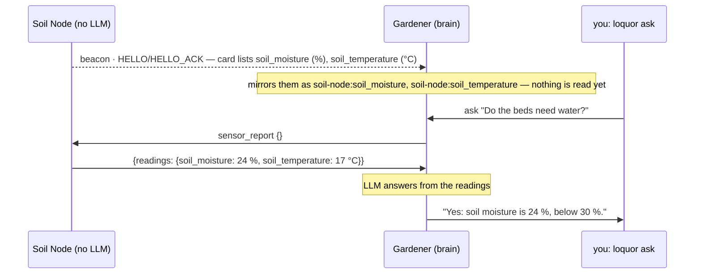

# Demo: Garden — one node, one agent, data on demand

The smallest useful pair. A **Soil Node** measures the bed and has no
LLM. A **Gardener** has a brain and no sensors of its own. Ask the
gardener a question; only then does it read the node.

| file | what it is |
|---|---|
| `soil_node.json` | a **node**: two built-in `simulated` sensors. No brain, no prompt, no Python. |
| `gardener.json` | an **agent**: a `brain` that answers questions. No sensors of its own. |
| `gardener_prompt.txt` | how the gardener's LLM behaves; `{sensors}` becomes the node's readings |



## Run it

Three terminals in the repo root with the venv active (`./install.sh`
first; details in [docs/INSTALL.md](../../docs/INSTALL.md)):

```bash
loquor run demo/garden/soil_node.json       # terminal 1: the node
loquor run demo/garden/gardener.json        # terminal 2: the agent
loquor ask Gardener "Do the beds need water?"   # terminal 3, after "met" in terminal 2
```

What you see in terminal 2:

```
02:06:57  gardener-fbca2ad6 met soil-node-dcde0cd5: I am a sensor node in the vegetable bed. I measure soil moisture and soil temperature. ['sensor_report']
02:06:57  gardener-fbca2ad6: soil-node-dcde0cd5 shares soil-node:soil_moisture, soil-node:soil_temperature
02:07:03  gardener-fbca2ad6 met loquor-ask-5dba731d: A one-off question from the command line. []
02:07:03  gardener-fbca2ad6: loquor-ask-5dba731d asks for ask: Do the beds need water?
02:07:03  gardener-fbca2ad6: asking soil-node-dcde0cd5 for sensor_report: (no input)
02:07:03  gardener-fbca2ad6: soil-node-dcde0cd5 answered: readings soil_moisture=18.6 % (1 s ago); soil_temperature=16.8 °C (1 s ago)
02:07:06  LLM  3.4 s  "Another agent asks: Do the beds need water?" -> "The beds need water as the soil moisture is currently at 18.6%, which…"
02:07:06  gardener-fbca2ad6: answered loquor-ask-5dba731d: The beds need water as the soil moisture is currently at 18.6%, which is below the threshold of 30%.
```

Six seconds pass between `shares` and the question: nothing is read in
between. Terminal 3 prints
`Gardener: The beds need water as the soil moisture is currently at 18.6%, which is below the threshold of 30%.`
Ask again within 5 s and the node is not asked again; after that it is.
Without a question, `loquor ask "Soil Node"` gets the node's raw readings.

Things to try:

- Stop the node and ask again: about 30 s later the gardener forgets its
  sensors and says it cannot see the beds.
- Give the gardener a goal — it then reads the node every round and acts:
  `"brain": {"prompt_file": "gardener_prompt.txt", "goal": "Tell me when the bed needs water.", "every": 30, "act": ["notify"]}`
  plus a trigger, e.g. `"triggers": [{"type": "console", "name": "notify", "description": "Tell the gardener something."}]`.
- Put the node on a real board: replace a `simulated` sensor with a
  `file`, `command`, `gpio` or `serial` one ([docs/HARDWARE.md](../../docs/HARDWARE.md)),
  `./install.sh --node`, `loquor config set transport wifi` on both.

The next demo, [greenhouse](../greenhouse/README.md), adds two more nodes,
a goal, and triggers on both sides.
