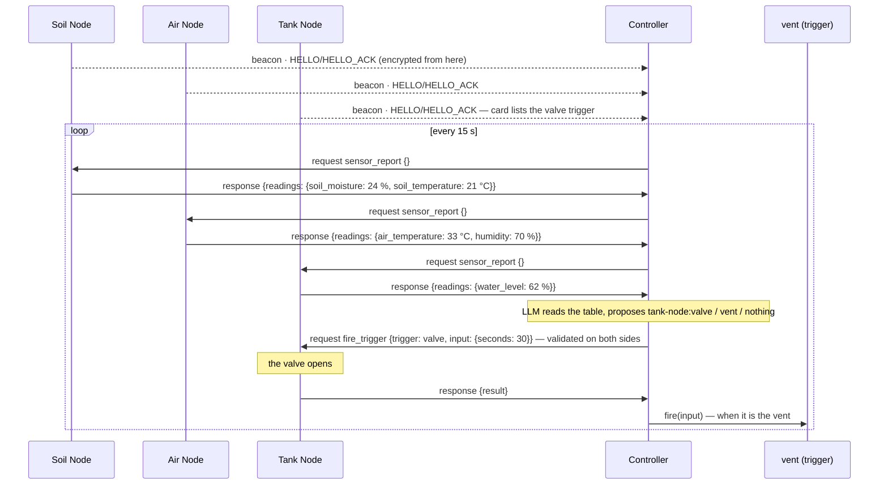

# Demo: Greenhouse — sensor nodes and one controller

Not every device needs a brain. Three **sensor nodes** — soil, air, water
tank — measure and report; they run no LLM, need no Ollama, and fit a
Raspberry Pi Zero. The tank node also **offers an action**: its
irrigation valve. One **controller** collects their readings every 15 s,
thinks once per round with its LLM, and acts: it opens the valve on the
tank node, or its own roof vent.

**Real:** the nodes, the protocol (keys, handshake, encryption), the
readings travelling as data straight from each node to the controller,
the controller's LLM decisions, the schema check before anything fires.
**Emulated:** the instruments (`simulated` sensors that drift) and the
actuators (they print instead of switching a relay).

| file | what it is |
|---|---|
| `node_soil.json`, `node_air.json` | **nodes**: built-in `simulated` sensors + `sensor_report`. No Python, no prompt, no LLM. |
| `node_tank.json` | a node that also **acts**: a `console` trigger named `valve` + `offer_triggers`. Still no Python. |
| `controller.json` | the **agent**: `collect` every 15 s from every node, with a goal; its own `vent` plus whatever the nodes offer |
| `controller_prompt.txt` | how the controller's LLM behaves |
| `actuators.py` | the controller's own **trigger**: the roof vent (stand-in for a relay) |



Nothing a node sends passes through a model: `sensor_report` answers
with the numbers, in an encrypted envelope addressed to the device that
asked, and `fire_trigger` carries a validated input the other way. The
controller's LLM is the only one in the picture.

## 1. Setup

On the controller's device: `./install.sh` (Ollama and a model). On a
node's device: `./install.sh --node` — no Ollama, no model, done in a
minute. On one computer for the demo, the normal install covers all four.

## 2. Run on one computer

Four terminals in the repo root with the venv active. Nodes first (any
order), then the controller:

```bash
loquor run demo/greenhouse/node_soil.json
loquor run demo/greenhouse/node_air.json
loquor run demo/greenhouse/node_tank.json
loquor run demo/greenhouse/controller.json
```

### What you will see

A node's terminal is quiet: it starts, meets the controller, and answers
every 15 s. The tank node also shows the valve opening when told to:

```
tank-node-51ab09c2 | id 51ab09c2… | model none (none) | transport localhost (127.0.0.1) | visible | Ctrl-C to stop
12:00:02  tank-node-51ab09c2 met greenhouse-controller-3d42fca5: I run the greenhouse… ['collected_readings']
12:00:03  tank-node-51ab09c2: greenhouse-controller-3d42fca5 asks for sensor_report: (no input)
12:00:03  tank-node-51ab09c2: answered greenhouse-controller-3d42fca5: readings water_level=62.0 % (2 s ago)
12:00:07  tank-node-51ab09c2: greenhouse-controller-3d42fca5 asks for fire_trigger: {"trigger": "valve", "input": {"seconds": 30}}

💧  VALVE OPEN for 30 s

12:00:07  TRIGGER valve {"seconds": 30} -> {"printed": 24}
12:00:07  tank-node-51ab09c2: answered greenhouse-controller-3d42fca5: {"trigger": "valve", "result": {"printed": 24}}
```

The controller's terminal, one round:

```
12:00:02  greenhouse-controller-3d42fca5: tank-node-51ab09c2 offers trigger tank-node:valve: Open the irrigation valve for a number of seconds…
12:00:03  greenhouse-controller-3d42fca5: collected from soil-node-9f1e2a3b: soil_moisture=24.0 % (1 s ago); soil_temperature=21.3 °C (1 s ago)
12:00:03  greenhouse-controller-3d42fca5: collected from air-node-7c0d11ee: air_temperature=33.5 °C (0 s ago); humidity=70.2 % (0 s ago)
12:00:03  greenhouse-controller-3d42fca5: collected from tank-node-51ab09c2: water_level=62.0 % (2 s ago)
12:00:07  LLM  3.8 s  "Your goal: Keep the plants healthy: soil moisture above 30 %…" -> "{ \"trigger\": \"tank-node:valve\", \"input\": { \"seconds\": 30 }, \"reason\": \"soil_moisture…"
12:00:07  greenhouse-controller-3d42fca5: round 1: firing tank-node:valve — soil_moisture is 24 %, below the 30 % limit, and the tank has 62 %
12:00:07  TRIGGER tank-node:valve {"seconds": 30} -> {"printed": 24}
```

and, when nothing is out of range, `round 2: no action — all readings
within limits`. The simulated sensors drift, so over a few minutes you
will see the vent open as the air warms past 35 °C and the valve stay
shut once the soil reading climbs.

From a fifth terminal:

```bash
loquor status "Greenhouse Controller"     # the table of every node's latest readings, rounds, last action
loquor status "Soil Node"                 # a node: its readings and who asked
loquor trace "Greenhouse Controller"      # the exact table the LLM saw and what it proposed
```

Things to try:
- Change `"start"` of `soil_moisture` in `node_soil.json` to 45 and restart that node: the pump stays off.
- Set `"start"` of `water_level` to 5: the soil is dry but the controller must not pump (the goal says so). `loquor trace` shows its reasoning.
- Drop `"goal"` and `"triggers"` from `controller.json`: the controller only collects, needs no LLM, and still serves `collected_readings` to other agents.
- Set `"min_trust": 1` on the tank node's `offer_triggers`: the controller is refused (`insufficient_trust`) until its key is pinned on the node (`~/.loquor/pinned_keys.json`).
- Give the air node a fan: add a `console` trigger named `fan` and `offer_triggers` to `node_air.json`; the controller picks it up as `air-node:fan` without any change on its side.
- Replace a `simulated` sensor with `{"type": "command", "command": "…"}`: a real instrument, still no Python.

## 3. Run on several devices

Each node on its own board with `./install.sh --node` and `loquor config
set transport wifi` (or `bluetooth`); the controller on any device with a
model. `loquor service install node_soil.json --now` keeps a node running
after a reboot. Nodes and controller must share one transport.

## 4. Troubleshooting

| Problem | Fix |
|---|---|
| controller logs nothing after `met` | the node must offer `sensor_report`: `loquor status <node>` shows `offers`; `collect` asks only peers that have it |
| `no readings from … : no response` | the node is gone or slow; it is asked again next round. `loquor status` on the node shows whether it is alive |
| `round N: no action` every time although a reading is out of range | `loquor trace "Greenhouse Controller" --full`: the table the LLM saw; tighten `controller_prompt.txt` or the goal, or a larger model |
| `no trigger fired: invalid input` | the proposal did not fit the schema (e.g. `seconds` out of 5–120); the reason is logged, nothing fires |
| `trigger failed: tank-node-… refused valve` | the node's own check said no: its schema, its offer list, or `min_trust`; the detail says which |
| the controller never sees `tank-node:valve` | the node needs both a trigger and `offer_triggers`; `loquor check node_tank.json` lists what it offers |
| a node device fails `loquor doctor` on Ollama | `loquor config set llm false` (what `install.sh --node` does); a node needs none |
| the controller refuses to start: `configured as a sensor node` | that device has `llm false`; run the controller on a device with Ollama, or `loquor config set llm true` |
