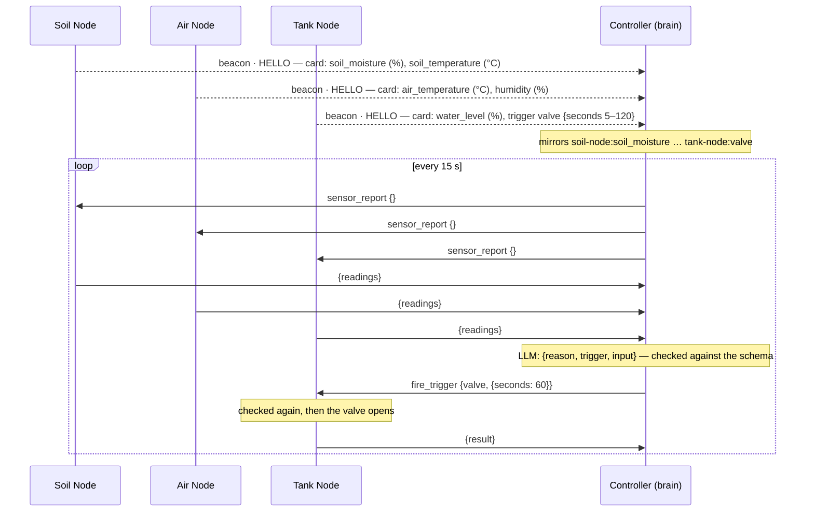

# Demo: Greenhouse — three nodes and one brain

Three **nodes** — soil, air, water tank — measure and have no LLM; a
Raspberry Pi Zero would do. The tank node can also **act**: it has the
irrigation valve. One **controller** has a brain with a goal: every 15 s
it reads the nodes, decides, and either opens the valve *on the tank
node* or its own roof vent — or does nothing, and says why.

**Real:** the nodes, the protocol (keys, handshake, encryption), the
readings travelling as data from each node to the controller, the
controller's LLM decisions, the schema checks on both sides before
anything fires. **Emulated:** the instruments (`simulated` sensors that
drift) and the actuators (`console` triggers that print).

| file | what it is |
|---|---|
| `node_soil.json`, `node_air.json` | **nodes**: two built-in `simulated` sensors each. No brain, no Python. |
| `node_tank.json` | a node that also **acts**: a `simulated` sensor and a `console` trigger named `valve`. Still no Python. |
| `controller.json` | the **agent**: its own `vent` trigger and a `brain` with a goal, `"every": 15`, `"act": ["vent", "tank-node:valve"]` |
| `controller_prompt.txt` | how the controller's LLM behaves |

No file says "share": a profile without a brain shares its sensors and
triggers with every agent in range by default. No file lists the nodes
either: the controller learns them from their capability cards.



## 1. Setup

On the controller's device: `./install.sh` (Ollama and a model). On a
node's device: `./install.sh --node` — no Ollama, no model. On one
computer for the demo, the normal install covers all four.

## 2. Run on one computer

Four terminals in the repo root with the venv active. Nodes first (any
order), then the controller:

```bash
loquor run demo/greenhouse/node_soil.json
loquor run demo/greenhouse/node_air.json
loquor run demo/greenhouse/node_tank.json
loquor run demo/greenhouse/controller.json
```

### What you will see

The controller, first contact and its first round (a real run with
`qwen2.5:3b`; descriptions shortened):

```
02:12:52  greenhouse-controller-dc1068b6 met tank-node-751c33bb: I am a sensor node on the irrigation water tank. … ['sensor_report', 'fire_trigger']
02:12:52  greenhouse-controller-dc1068b6: tank-node-751c33bb shares tank-node:water_level, tank-node:valve
02:12:52  greenhouse-controller-dc1068b6 met soil-node-dcde0cd5: I am a sensor node in the greenhouse bed. … ['sensor_report']
02:12:52  greenhouse-controller-dc1068b6: soil-node-dcde0cd5 shares soil-node:soil_moisture, soil-node:soil_temperature
02:12:52  greenhouse-controller-dc1068b6 met air-node-f6f2c484: I am a sensor node under the greenhouse roof. … ['sensor_report']
02:12:52  greenhouse-controller-dc1068b6: air-node-f6f2c484 shares air-node:air_temperature, air-node:humidity
02:12:52  greenhouse-controller-dc1068b6: asking tank-node-751c33bb for sensor_report: (no input)
02:12:52  greenhouse-controller-dc1068b6: asking soil-node-dcde0cd5 for sensor_report: (no input)
02:12:52  greenhouse-controller-dc1068b6: asking air-node-f6f2c484 for sensor_report: (no input)
02:12:52  greenhouse-controller-dc1068b6: soil-node-dcde0cd5 answered: readings soil_moisture=23.9 % (0 s ago); soil_temperature=20.9 °C (0 s ago)
02:12:52  greenhouse-controller-dc1068b6: tank-node-751c33bb answered: readings water_level=60.1 % (0 s ago)
02:12:52  greenhouse-controller-dc1068b6: air-node-f6f2c484 answered: readings air_temperature=33.2 °C (0 s ago); humidity=70.9 % (0 s ago)
02:12:54  LLM  1.8 s  "Your goal: Keep the plants healthy: soil moisture above 30 %, air bel…" -> "{ \"reason\": \"Soil moisture is below the goal threshold of 30%, which …"
02:12:54  greenhouse-controller-dc1068b6: round 1: firing tank-node:valve — Soil moisture is below the goal threshold of 30%, which requires immediate attention to prevent plant dehydration.
02:12:54  greenhouse-controller-dc1068b6: asking tank-node-751c33bb for fire_trigger: {"trigger": "valve", "input": {"seconds": 60}}
02:12:54  greenhouse-controller-dc1068b6: tank-node-751c33bb answered: {"trigger": "valve", "result": {"printed": 24}}
02:12:54  TRIGGER tank-node:valve {"seconds": 60} -> {"printed": 24}
```

The tank node, at the same moment — it has no LLM; it checks the input
against its own schema and runs its trigger:

```
02:12:54  tank-node-751c33bb: greenhouse-controller-dc1068b6 asks for fire_trigger: {"trigger": "valve", "input": {"seconds": 60}}

💧  VALVE OPEN for 60 s
```

The simulated sensors drift and do not respond to watering, so over a
few minutes you will see the valve again while the soil stays dry, the
vent open as the air passes 35 °C, and `round N: no action — …` when
everything is inside its limits.

A 3B model decides right most of the time, not always: it sometimes
misreads a comparison ("42 % is below 30 %"). `loquor trace` shows the
exact prompt and reply; a larger model is steadier. Whatever it
proposes, the valve never opens for less than 5 or more than 120 s —
that is the schema in `node_tank.json`, checked on both devices.

From a fifth terminal:

```bash
loquor status "Greenhouse Controller"     # the nodes' sensors as it sees them, the last action, the goal
loquor status "Tank Node"                 # a node: its reading, who fired its valve
loquor trace "Greenhouse Controller" --full   # the exact readings the LLM saw and what it proposed
loquor ask "Soil Node"                    # the soil node's readings, from the command line
```

Things to try:

- Set `"start"` of `water_level` in `node_tank.json` to 5: the soil is
  dry but the controller must not water (the goal says so). `loquor
  trace` shows its reasoning.
- Give the air node a fan: add a `console` trigger named `fan` to
  `node_air.json`. The controller picks it up as `air-node:fan`; add it
  to `act` to let the brain use it.
- Set `"share": {"min_trust": 1}` on the tank node: the controller is
  refused (`insufficient_trust`) until its key is pinned on the node —
  `loquor check demo/greenhouse/controller.json` prints the `pin entry`
  for the tank node's `~/.loquor/pinned_keys.json`.
- Replace a `simulated` sensor with a real one, still without Python:
  `file`, `command`, `gpio`, `serial` ([docs/HARDWARE.md](../../docs/HARDWARE.md)).

## 3. Run on several devices

Each node on its own board with `./install.sh --node` and `loquor config
set transport wifi` (or `bluetooth`); the controller on any device with a
model. `loquor service install node_soil.json --now` keeps a node running
after a reboot. Nodes and controller must share one transport.

## 4. Troubleshooting

| Problem | Fix |
|---|---|
| the controller never thinks | it waits for `"min_peers": 3`; `loquor status "Greenhouse Controller"` lists the peers it sees |
| `met` a node but no `shares` line | the node shares nothing: a `"share": false`, or hand-written `skills` without `sensor_report` |
| `round N: no action` every time although a reading is out of range | `loquor trace "Greenhouse Controller" --full`: the readings the LLM saw; tighten `controller_prompt.txt` or the goal, or a larger model |
| `no action — invalid input …` | the proposal did not fit the schema (e.g. `seconds` out of 5–120); the reason is logged, nothing fires |
| `trigger failed: tank-node-… refused valve` | the node's own check said no: its schema, or `min_trust`; the detail says which |
| a reading shows `not in range` | that node is not heard (stopped, or another transport); its parts disappear 30 s after it goes silent |
| a node device fails `loquor doctor` on Ollama | `loquor config set llm false` (what `install.sh --node` does); a node needs none |
| the controller refuses to start: `configured as a sensor node` | that device has `llm false`; run the controller on a device with an LLM, or `loquor config set llm true` |
