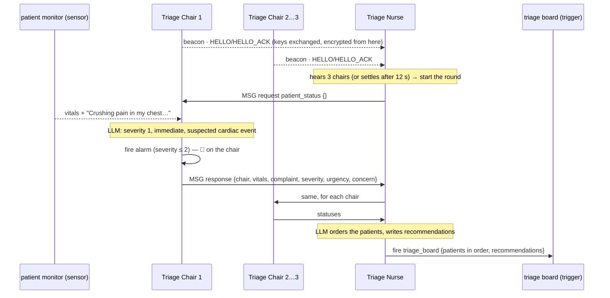

# Demo: Emergency Triage

An emergency department waiting area with **automated triage chairs**. A
patient sits down; the chair measures temperature, heart rate, blood
pressure and oxygen, asks "how do you feel?", and its LLM assesses how
serious the case is. A **nurse** arrives with a laptop (or a tablet, or a
badge — any device); her agent asks every chair for its patient's status,
and her LLM decides whom to see first and what to do.

Four agents, four processes: three chairs and the nurse. Nothing is
central: the chairs never talk to each other, the nurse's device finds them
by their beacons.



What each file is:

| file | role | contract it implements |
|---|---|---|
| `patient_simulator.py` | the chair's sensor: vitals + the patient's answer; a `scenario` per chair | `Sensor.read()` |
| `triage_assessment.py` | the chair's skill: sensor → LLM → structured status; fires `alarm` directly for severity ≤ 2 | `Skill.handle()`, capability `patient_status` |
| `triage_round.py` | the nurse's skill: ask every chair, LLM orders, fire the board | `Skill.run()` |
| `triage_board.py` | the nurse's trigger: the board on screen | `Trigger.fire()` + input schema |
| `chair_1..3.json`, `nurse_agent.json` | the profiles wiring them together | — |

Replace `patient_simulator.py` with a driver for a real cuff and oximeter
and nothing else changes.

## 1. Setup (once per device)

Needs Python 3.10+ and [Ollama](https://ollama.com). In the repo root:

```bash
python3 -m venv .venv
source .venv/bin/activate
pip install -r requirements.txt
ollama pull qwen2.5:3b
```

## 2. Run on one computer

Four terminals in the repo root with the venv active. Start the chairs
first (any order), then the nurse:

```bash
python run_agent.py demo/triage/chair_1.json --wire off    # chest pain
python run_agent.py demo/triage/chair_2.json --wire off    # flu
python run_agent.py demo/triage/chair_3.json --wire off    # breathing difficulty
python run_agent.py demo/triage/nurse_agent.json --wire off
```

Two chairs are enough: set `"expected_chairs": 2` in `nurse_agent.json`, or
leave it and the nurse starts 12 s after hearing the first chair.

### What you will see

The nurse's terminal, about a minute end to end with a 3B model (each chair
runs one LLM assessment, then the nurse runs one ranking):

```
triage-nurse-9c1e… | id … | model qwen2.5:3b (ollama) | transport profile (127.0.0.1) | visible | Ctrl-C to stop
triage-nurse-9c1e… met triage-chair-1-…: I am an automated emergency triage chair… ['patient_status', 'sensor_report']
triage-nurse-9c1e… met triage-chair-2-…
triage-nurse-9c1e… met triage-chair-3-…
triage-nurse-9c1e…: asking 3 chair(s) for their patients' status
BODY  request  -> triage-chair-1-… {"capability": "patient_status", "input": {}}
BODY  response <- triage-chair-1-… {"output": {"chair": "Triage Chair 1", "vitals": {"temperature_c": 37.1, "heart_rate_bpm": 118, "blood_pressure": "162/94", "spo2_percent": 94}, "complaint": "Crushing pain…", "severity": 1, "urgency": "immediate", "concern": "Possible acute coronary syndrome", …}}
…
TRIGGER triage_board {"patients": [{"chair": "Triage Chair 1", "priority": 1, "severity": 1, …

╭──────────────────────────────────────────────────────────────────────╮
│ 🏥  TRIAGE BOARD — see patients in this order                        │
│                                                                      │
│ 1. 🔴 Triage Chair 1   severity 1, immediate                         │
│       Possible acute coronary syndrome                               │
│       ↳ Chest pain radiating to the arm with tachycardia…            │
│ 2. 🟠 Triage Chair 3   severity 2, within 15 minutes                 │
│       Respiratory distress with low oxygen saturation                │
│ 3. 🟡 Triage Chair 2   severity 3, within 1 hour                     │
│       Influenza-like illness                                         │
│                                                                      │
│ Recommendations                                                      │
│   • Chair 1: ECG now, prepare for cardiac pathway.                   │
│   • Chair 3: supplemental oxygen, reassess SpO2 in 5 minutes.        │
╰──────────────────────────────────────────────────────────────────────╯
```

Each chair's terminal shows its own assessment, and chairs 1 and 3 print
`🚨  ALARM  Triage Chair 1: severity 1 — …` the moment they assess a severe
case: the chair decided that itself, without waiting for the nurse.

Where the decisions are made:

| decision | who | how |
|---|---|---|
| how serious is this patient | the chair's LLM | JSON with `severity`, `urgency`, `concern`, clamped by code |
| raise the chair's alarm | the chair's code | `severity ≤ 2` → `ctx.triggers.fire("alarm", …)` — no LLM in the loop |
| whom to see first, what to do | the nurse's LLM | JSON order + recommendations; anyone the model forgets is appended by severity |
| show the board | the nurse's code | `ctx.triggers.fire("triage_board", …)`, validated against the trigger's schema |

Things to try:
- Restart a chair with a different `"scenario"` (`sprain`, `headache`) and
  restart the nurse: the order changes.
- Ask a chair for raw numbers: `sensor_report` is on every chair, so any
  agent can `ctx.ask(chair, "sensor_report", {})` and get the vitals as data.
- `--visibility quiet` on the nurse: she never beacons, but still finds the
  chairs and asks them.

## 3. Run on several devices

Chairs and the nurse's device on the same Wi-Fi or hotspot; each set up as
in step 1; add `--transport wifi` to every command. A chair can be a
Raspberry Pi with a cuff on its UART; the nurse's device can be anything
with Python and a local model.

## 4. Troubleshooting

| Problem | Fix |
|---|---|
| nurse says `no patient statuses` | the chairs took longer than `ask_timeout` (90 s) — a slow model; try `--model qwen2.5:1.5b` on the chairs |
| nurse never starts the round | it needs to hear at least one chair; check both sides use the same `--transport` |
| `model ... is not available in Ollama` | `ollama pull qwen2.5:3b` |
| board order looks wrong | the model ranked it; the chairs' severities are shown next to each patient so you can judge |
