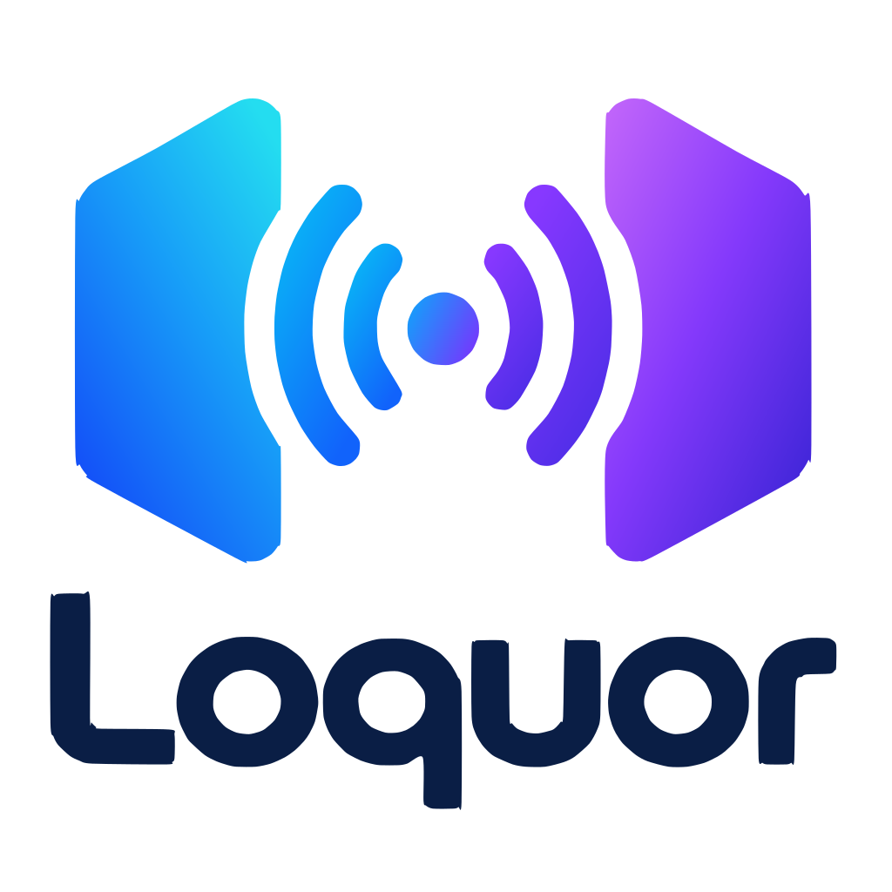

  

# Vision

## The name

*loquor* (Latin) — "I speak", "I talk", "I say". **aac** stands for *agent-to-agent communication*.

## The main idea

Provide the capability for multiple AI agents on different devices to communicate with each other **offline**, using any available transport — UWB, Bluetooth, Wi-Fi, or others.

Today's multi-agent systems assume connectivity: agents live in the cloud, or on a LAN with a central broker, and coordination depends on infrastructure that may not exist where the devices actually are — a factory floor, a mine, a ship, a disaster area, a vehicle convoy, a warehouse of robots.

Loquor's premise is the opposite:

- **Each device runs its own AI agent** (a local model plus deterministic application logic) and **stores its own private knowledge**. There is no shared database and no central coordinator.
- **Agents meet opportunistically.** When two devices come into range on any local transport, their agents discover each other, authenticate, and exchange capabilities — without knowing about each other in advance.
- **Collaboration is structured, not conversational.** Agents exchange a small set of validated message types (task requests, evidence requests, results). A local LLM interprets evidence and proposes hypotheses; deterministic logic controls task state, retries, permissions, and final output.
- **Disconnection is normal, not an error.** Devices move, radios drop. Task state is persisted on both sides, so an unfinished exchange resumes on reconnection without losing progress or duplicating results.
- **Transport is an implementation detail.** The agent and networking layers are independent. The same agent application should run over Wi-Fi/IP, BLE, UWB, or a mesh by swapping transport adapters.

## Why it matters

Two independent intelligences with separate knowledge performing a coordinated task is qualitatively different from one model answering a question. Each agent contributes what only it knows (its sensors, its records, its history) and what only it can do (take a local measurement, actuate something). The collaboration should produce results neither device could produce alone — and that is measurable (see Test 3 in the [PoC plan](history/POC_PLAN.md)).

## Semantic grounding

Rather than inventing a new semantic standard, loquor borrows task and capability concepts from Google's [A2A protocol](https://github.com/a2aproject/A2A) — capabilities advertised at discovery, tasks with ids and lifecycle states, structured payloads — and applies them in an offline, transport-agnostic setting that LAN-connected multi-agent systems don't address.
